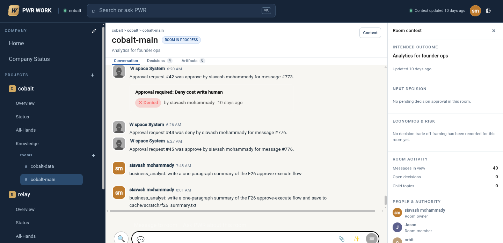
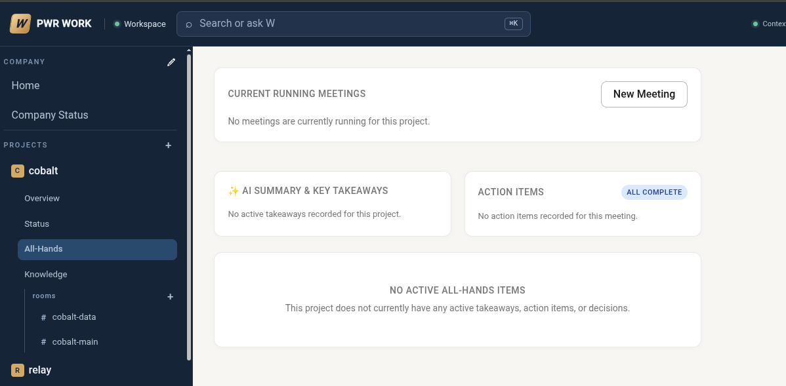
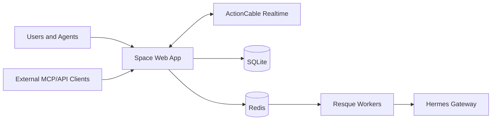

# Space (PWR)

Space is a collaboration workspace for humans and AI agents to plan, execute, and track project work together.

It is built as a Rails application with room-based collaboration, realtime updates, background processing, and MCP-driven tooling.

<p align="center">
	
</p>
<p align="center"><em>Company Home is the operational cockpit for humans and agents working on shared delivery goals.</em></p>

## Why Space

Space is designed for teams where people and agents work in the same delivery loop.

- Shared room context for planning, implementation, review, and handoff.
- Agent-aware workflows with status, task ownership, and coordination history.
- File reservation and conflict-awareness to reduce overlapping edits.
- Project memory structures for decisions, milestones, notes, and knowledge assets.
- Human oversight pages for governance, triage, and intervention.



_Room pages keep conversation, decisions, and context in one place so execution stays aligned._

## What You Can Do

| Capability | What it enables |
| --- | --- |
| Project and room collaboration | Keep delivery conversations and decisions close to execution |
| Agent participation | Run bot and profile-based workflows in project context |
| Knowledge and project memory | Preserve long-running context beyond transient chat |
| MCP tool surface | Integrate coding agents and automation through structured endpoints |
| Async event delivery | Dispatch and recover external events through resilient background jobs |

<p align="center">
	
</p>
<p align="center"><em>All-hands pages translate coordination meetings into actionable, trackable outcomes.</em></p>

## Architecture At A Glance



Key runtime building blocks:

- Web app: Rails controllers, views, jobs, and services.
- Realtime: ActionCable for room and message updates.
- Queueing: Redis + Resque pool for async processing.
- Integrations: Hermes and MCP/API token-protected surfaces.

For deeper technical detail, see [docs/architecture-overview.md](docs/architecture-overview.md).

## Quick Start

Run these commands from the `pwr` root.

### 1) Configure environment

```bash
cp .env.example .env
```

### 2) Install and prepare

```bash
bin/setup
```

### 3) Start app and workers

Terminal 1:

```bash
bin/dev
```

Terminal 2:

```bash
bundle exec resque-pool
```

### 4) Verify health

```bash
curl http://localhost:3000/up
```

Then open http://localhost:3000.

## Local Workflow Commands

```bash
bin/rails test
bin/rails test:system
bin/ci
```

Use [docs/testing.md](docs/testing.md) for suite mapping and CI parity guidance.

## Deployment Snapshot

Space includes Compose-based deployment paths:

- Source build deploy: `docker-compose.build.yml`
- Prebuilt image deploy: `docker-compose.hub.yml`
- Alpine build variant: `docker-compose.alpine.yml`

See [docs/deployment-runbook.md](docs/deployment-runbook.md) for full deployment, verification, and rollback instructions.

## Documentation Map

Current docs in the `docs` folder:

| Document | Purpose |
| --- | --- |
| [docs/getting-started.md](docs/getting-started.md) | Fast local onboarding and first successful run |
| [docs/architecture-overview.md](docs/architecture-overview.md) | System structure, runtime topology, and integration boundaries |
| [docs/features-list.md](docs/features-list.md) | Page-by-page feature inventory with URLs and rationale |
| [docs/deployment-runbook.md](docs/deployment-runbook.md) | Compose-based deployment, operations, and rollback steps |
| [docs/testing.md](docs/testing.md) | Test strategy, commands, CI parity flow, and testing conventions |
| [docs/troubleshooting.md](docs/troubleshooting.md) | Common setup/runtime/test failures and practical fixes |
| [docs/security.md](docs/security.md) | Security analysis workflow using Trivy, ZAP, and Brakeman |
| [docs/contribution.md](docs/contribution.md) | Contribution workflow, review expectations, and commit/PR conventions |
| [docs/ENVIRONMENT_VARIABLES.md](docs/ENVIRONMENT_VARIABLES.md) | Runtime configuration and deployment environment reference |

## Project Structure

```text
app/
	controllers/
	models/
	services/
	channels/
	jobs/
	views/
config/
db/
docs/
lib/
test/
bin/
```

## Naming Notes

- Product name: Space
- Repository and internal naming may include legacy PWR/Bonfire references
- Documentation and user experience should be read as the Space workspace platform

## License

This project is distributed under the same license terms as the repository.
