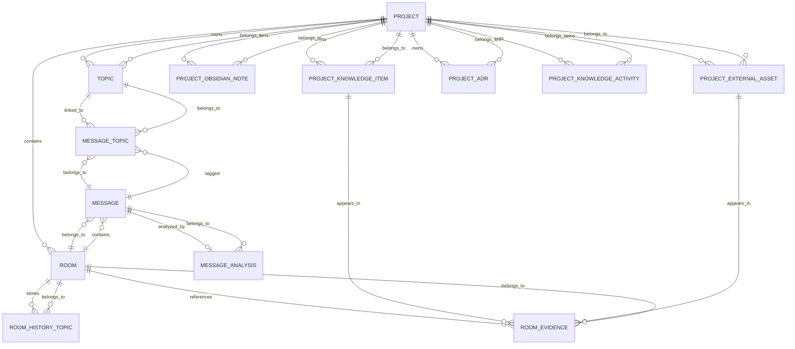

# Bonfire Knowledge MCP

This document explains the knowledge-focused Model Context Protocol (MCP) in Bonfire and the database relationships behind it.

## What the Knowledge MCP is

The knowledge MCP in Bonfire is the subset of MCP tools registered for knowledge-related workflows. It is defined in [../app/services/mcp.rb](../app/services/mcp.rb) and served from the knowledge endpoint mounted in [../config/routes.rb](../config/routes.rb).

The knowledge-scoped tool group covers:

- topic management
- message analysis
- message/topic linking
- room history topics
- project knowledge items
- project decision records / ADRs
- obsidian notes
- external knowledge assets
- project activity logs
- summary items

The knowledge endpoint is:

- `POST /knowledge-mcp`

The broader native MCP endpoints are:

- `POST /mcp`
- `POST /action-mcp`
- `POST /read-mcp`
- `POST /task-mcp`

## Where it is registered

The tool registry is in [../app/services/mcp.rb](../app/services/mcp.rb). The relevant registrations include:

- `hello`
- `topics`, `get_topic`, `create_topic`, `update_topic`, `delete_topic`
- `message_analysis`, `get_message_analysis`, `create_message_analysis`, `update_message_analysis`, `delete_message_analysis`
- `message_topics`, `get_message_topic`, `create_message_topic`, `update_message_topic`, `delete_message_topic`
- `room_history_topics`, `get_room_history_topic`, `create_room_history_topic`, `update_room_history_topic`, `delete_room_history_topic`
- `project_knowledge_items`, `add_project_knowledge_item`, `edit_project_knowledge_item`, `delete_project_knowledge_item`
- `project_decision_records`, `add_project_decision_record`, `edit_project_decision_record`, `delete_project_decision_record`
- `project_obsidian_note`, `add_project_obsidian_note`, `edit_project_obsidian_note`, `delete_project_obsidian_note`
- `tree_based_project_directory_data`, `add_tree_based_project_directory_item`, `edit_tree_based_project_directory_item`, `delete_tree_based_project_directory_item`
- `external_knowledge_assets`, `add_external_knowledge_asset`, `edit_external_knowledge_asset`, `delete_external_knowledge_asset`
- `knowledge_activity_log`, `add_knowledge_activity_log`, `edit_knowledge_activity_log`, `delete_knowledge_activity_log`
- `knowledge_summary_items`, `add_knowledge_summary_item`, `edit_knowledge_summary_item`, `delete_knowledge_summary_item`

The concrete implementations live in:

- [../app/services/mcp/tools/topics.rb](../app/services/mcp/tools/topics.rb)
- [../app/services/mcp/tools/project_knowledge.rb](../app/services/mcp/tools/project_knowledge.rb)

## Knowledge concepts in the system

### 1. Topics

Topics are reusable knowledge labels or themes. They belong to a project and can be linked to many messages.

Implementation:

- [../app/models/topic.rb](../app/models/topic.rb)

Key behavior:

- `belongs_to :project`
- `belongs_to :parent_topic` (optional hierarchical topic tree)
- `has_many :message_topics`
- `has_many :messages, through: :message_topics`

### 2. Message analysis

Each message can have a structured analysis record describing importance, summary, type, and tags.

Implementation:

- [../app/models/message_analysis.rb](../app/models/message_analysis.rb)

Key behavior:

- `belongs_to :message`
- validates presence of `importance_level`, `message_content_summary`, and `message_type`

### 3. Message-topic links

This joins messages and topics so a message can belong to multiple topic contexts.

Implementation:

- [../app/models/message_topic.rb](../app/models/message_topic.rb)

Key behavior:

- `belongs_to :message`
- `belongs_to :topic`

### 4. Room history topics

Room snapshots capture the latest topic state for a room over time.

Implementation:

- [../app/models/room_history_topic.rb](../app/models/room_history_topic.rb)

Key behavior:

- `belongs_to :room`
- used for room-level historical topic tracking

### 5. Project knowledge items

These are project-specific knowledge records, usually describing a reusable insight, fact, or project artifact.

Implementation:

- [../app/models/project_knowledge_item.rb](../app/models/project_knowledge_item.rb)

Key behavior:

- `belongs_to :project`
- `has_many :room_evidences`
- `has_many :rooms, through: :room_evidences`

### 6. Project evidence and provenance

A `RoomEvidence` record binds a knowledge item or external asset to a specific room and project while preserving provenance metadata.

Implementation:

- [../app/models/room_evidence.rb](../app/models/room_evidence.rb)

This is the bridge between project knowledge and room context.

### 7. Other project knowledge entities

The knowledge MCP also covers project-level records such as:

- [../app/models/project_obsidian_note.rb](../app/models/project_obsidian_note.rb)
- [../app/models/project_external_asset.rb](../app/models/project_external_asset.rb)
- [../app/models/project_adr.rb](../app/models/project_adr.rb)
- [../app/models/project_knowledge_activity.rb](../app/models/project_knowledge_activity.rb)

These are all associated to projects and support long-lived project memory.

## Database relation diagram

## Practical interpretation

The knowledge MCP is not a single table or single model. It is a layered memory system built from:

1. project-level durable knowledge records
2. room-level discussion and context snapshots
3. message-level topic tagging and analysis
4. evidence linking between rooms and project knowledge

This gives Bonfire a working structure for:

- summarizing project knowledge
- linking messages to topics
- recording topic history by room
- surfacing project insights and decisions
- keeping project memory separate from transient conversation state

## Related files

- [../app/services/mcp.rb](../app/services/mcp.rb)
- [../app/services/mcp/tools/topics.rb](../app/services/mcp/tools/topics.rb)
- [../app/services/mcp/tools/project_knowledge.rb](../app/services/mcp/tools/project_knowledge.rb)
- [../app/models/project.rb](../app/models/project.rb)
- [../app/models/room.rb](../app/models/room.rb)
- [../app/models/message.rb](../app/models/message.rb)
- [../app/models/topic.rb](../app/models/topic.rb)
- [../app/models/project_knowledge_item.rb](../app/models/project_knowledge_item.rb)
- [../app/models/room_evidence.rb](../app/models/room_evidence.rb)
